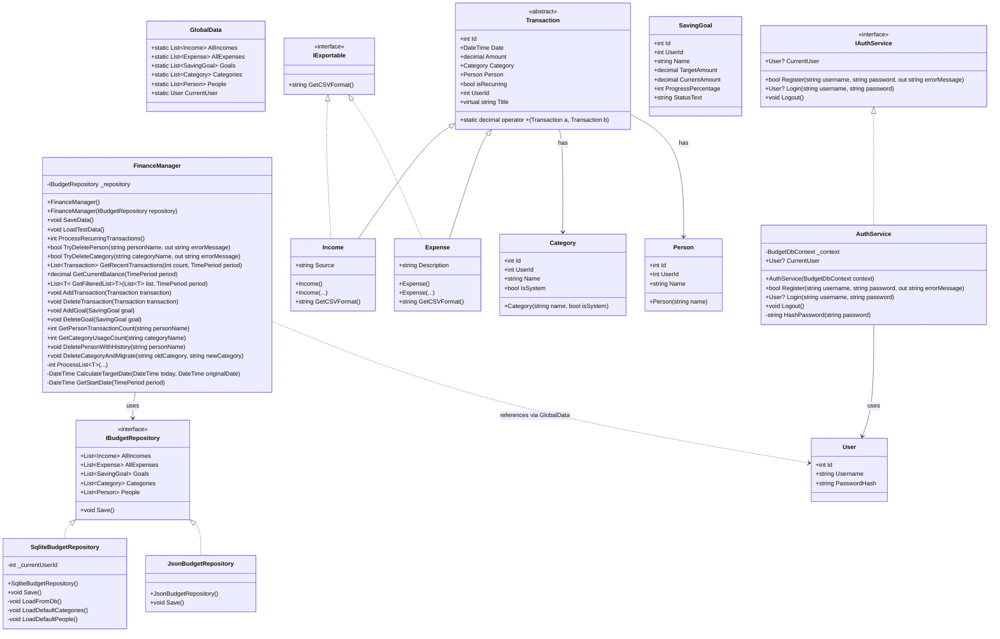

# Diagram UML i Model Obiektowy

## Diagram Klas (UML)

## Model Obiektowy - Analiza (Rozszerzona)

Projekt jest zbudowany zgodnie z zasadami programowania obiektowego (OOP), co zapewnia jego czytelność, łatwość w utrzymaniu i rozbudowie.

### 1. Dziedziczenie (Inheritance)
Klasa `Transaction` stanowi fundament dla wszystkich operacji finansowych.
- `Income` (przychód) i `Expense` (wydatek) dziedziczą po klasie `Transaction`.
- Pozwala to na współdzielenie kodu (np. właściwości `Date`, `Amount`) oraz polimorficzne traktowanie różnych typów transakcji w listach (np. w metodzie `GetRecentTransactions`).

### 2. Abstrakcja (Abstraction)
- **Klasa abstrakcyjna `Transaction`**: Nie można utworzyć samego obiektu "Transakcja" – musi to być konkretnie Przychód lub Wydatek. Wymusza to precyzję w modelu danych.
- **Interfejsy (`IBudgetRepository`, `IExportable`, `IAuthService`)**: Definiują kontrakt, czyli "co" klasa ma robić, ale nie "jak".
    - `IBudgetRepository`: Pozwala na łatwą zmianę sposobu zapisu danych (np. plik JSON vs baza SQLite) bez konieczności zmian w logice `FinanceManager`.
    - `IAuthService`: Oddziela logikę uwierzytelniania od reszty aplikacji.

### 3. Hermetyzacja (Encapsulation)
- Wszystkie pola danych w klasach (np. `Amount` w `Transaction`, `PasswordHash` w `User`) są ukryte za właściwościami publicznymi (Properties).
- Wewnętrzne metody pomocnicze w `FinanceManager` (np. `ProcessList`, `GenerateExpenseId`) są prywatne (`private`), co ukrywa skomplikowaną logikę przed światem zewnętrznym.
- Dostęp do bazy danych jest schowany w Repozytoriach (`SqliteBudgetRepository`), dzięki czemu warstwa prezentacji (Formularze) nie musi wiedzieć nic o SQL.

### 4. Polimorfizm (Polymorphism)
- Metoda `GetCSVFormat` z interfejsu `IExportable` działa inaczej dla `Income` (zapisuje źródło) i dla `Expense` (zapisuje opis), ale wywoływana jest w ten sam sposób.
- Użycie `List<Transaction>` w `FinanceManager` pozwala przechowywać na jednej liście oba typy obiektów.

### 5. Elementy Statyczne i Helpery
- Klasa `AppConstants` przechowuje stałe systemowe (np. nazwy kategorii).
- Metoda statyczna operatora `+` w `Transaction` pozwala na eleganckie sumowanie transakcji w kodzie: `suma = transakcja1 + transakcja2`.

### 6. Relacje
- **Kompozycja**: Obiekt `Transaction` zawiera obiekty `Category` i `Person`. Są one niezbędne do istnienia pełnej transakcji.
- **Asocjacja**: `FinanceManager` korzysta z `IBudgetRepository`.
